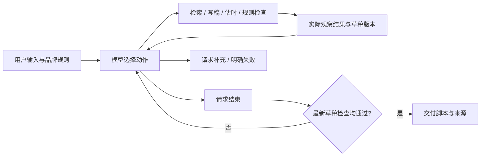

# 短视频脚本 Agent

**用可核验事实生成可编辑脚本，让时长与规则检查决定下一步。**

Python 原生工具循环 · OpenAI 兼容接口 · 离线 Mock · 逐镜来源和时间线 · 无运行时第三方依赖

> 已接入 **DeepSeek `deepseek-chat`** 并保存真实运行记录。自然生成路径、受控反馈实验、离线 Mock 分别标注；失败尝试也保留。详见 [评估报告](docs/03-evaluation.md)。

## 评审先看这三处

- [真实模型超时长修正](examples/live/controlled_over_duration/report.md)：工具计算的偏长草稿由测试夹具提供，后续改稿、复查、结束均由模型决策。
- [验收结果与限制](docs/03-evaluation.md)：覆盖全部题目场景，不把测试通过当作模型准确率。
- [方案与事实守卫](docs/02-solution.md)：P01 仅“支持字幕”，不允许扩写成“自动识别”或“效率提升80%”。

## 运行

Python **3.11+**，Windows / Linux / macOS。以下命令从仓库根目录执行：

```powershell
python -m pip install -e .
python -m script_agent.cli --provider mock --input examples/inputs/over_duration.json --output runs/demo
python -m unittest discover -s tests -v
python scripts/evaluate.py --provider mock
python scripts/verify_evidence.py
```

不安装包也可运行：PowerShell 先 `$env:PYTHONPATH='src'`；Bash 先 `export PYTHONPATH=src`，再执行上面 Python 命令。Mock 无需配置环境变量、API 或 GPU。`result.json` 是可编辑结构化输出，`report.md` 是分镜表与简短动作记录。

### 真实模型

在本机设置环境变量，不要将密钥发到聊天或写进提交文件。`.env.example` 仅作模板，程序不自动加载 `.env`。

```powershell
$env:SCRIPT_AGENT_API_KEY = '<仅在本机填写>'
$env:SCRIPT_AGENT_BASE_URL = 'https://api.deepseek.com/v1'
$env:SCRIPT_AGENT_MODEL = 'deepseek-chat'
python -m script_agent.cli --provider live --input examples/inputs/over_duration.json --output runs/live-demo
python scripts/evaluate.py --provider live
python scripts/probe_model.py
```

使用 OpenAI 时可省略 BASE_URL / MODEL，默认 `https://api.openai.com/v1` / `gpt-4.1-mini`。只使用模型选择的外部 JSON 动作，不依赖供应商的原生 function calling。调用产生正常 API 费用；无 Key 时明确报错，live 失败不会偷偷切成 Mock。

### 输入和故障验证

```json
{"topic":"字幕助手","audience":"新手视频创作者","platform":"抖音","target_seconds":30,"style":"简洁介绍"}
```

```powershell
python -m script_agent.cli --input examples/inputs/missing_info.json
python -m script_agent.cli --input examples/inputs/normal.json --materials data/no_materials.json
python -m script_agent.cli --input examples/inputs/normal.json --simulate-search-failure
python -m script_agent.cli --input examples/inputs/normal.json --max-steps 2
```

退出码：0 完成；1 配置/输入文件错误；2 需要补充；3 明确失败；4 达执行上限未完成。模拟故障是显式测试参数，生产调用不要启用。目标时长是上限，不承诺填满。

## 决策循环



主机只管理工具安全边界和终态门禁。真实模式每轮下一步由模型选择；Mock 中的预设观察响应仅用于工程测试。默认 14 步、单次 API 超时 35 秒，达到上限返回 `incomplete`。

## 目录

```text
src/script_agent/  # agent / providers / tools / CLI
tests/            # 正向、故障、篡改与反馈差异测试
data/             # 合成事实与品牌白名单
examples/inputs/  # 可复用输入
examples/mock/    # 实际离线输出、逐步 Trace、分镜报告
examples/live/    # DeepSeek 实际输出、受控反馈、保留失败尝试
scripts/          # 一键生成验收证据
docs/             # 需求、方案、评估、AI 使用、复盘
.github/workflows/# Python 3.11–3.13 离线 CI
```

## 已知边界

采用保守的“逐字事实引用 + 品牌创意白名单”，会拒绝未经批准的同义改写。素材需由人工先整理为可发布事实，不能把任意网页自动当作真相。时长为启发式估算，未验证实际配音；未做真实平台政策和法律审查。素材只有一个事实时，生成空间有限。完整限制和后续计划见 [复盘](docs/05-retrospective.md)。

本项目使用 AI 辅助实现；候选人实际贡献与待确认部分详见 [AI 使用说明](docs/04-ai-usage.md)。最终提交信息见 [SUBMISSION.md](SUBMISSION.md)。
